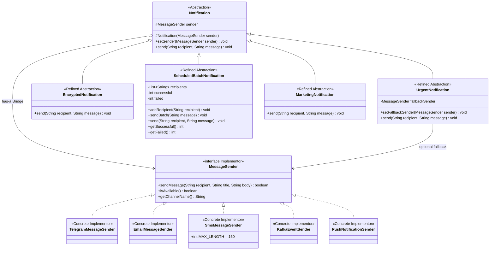

# Assignment 3 Multi Channel Notification Gateway

This Java 17 project demonstrates the **Bridge pattern**. Notification rules and delivery providers are separate class hierarchies. The same notification can use a different provider at runtime. All providers print simulated deliveries; no accounts or external messaging APIs are needed.

## Run the application

Open a PowerShell terminal in this folder:

```powershell
./run.ps1
./test.ps1
```

The scripts use `C:\Program Files\Java\jdk-17`. For another installation:

```powershell
./run.ps1 -JdkPath 'C:\path\to\jdk-17'
./test.ps1 -JdkPath 'C:\path\to\jdk-17'
```

The first test run downloads the JUnit 5 console runner from Maven Central. Later runs reuse it. The application itself has no external dependencies.

With Maven and JDK 17 or newer, on any operating system:

```sh
mvn test
mvn package
java -cp target/classes Main
```

Without Maven, compile and run the demo from this folder:

```sh
mkdir -p build/classes
javac -encoding UTF-8 -d build/classes src/main/java/*.java
java -cp build/classes Main
```

The last commands use a POSIX shell. Windows users can use `run.ps1`.

## Mandatory demonstration

`Main` runs these scenarios in order:

| Number | Scenario | Expected behavior |
| --- | --- | --- |
| 1 | Urgent notification through Telegram | Formatted message containing `[URGENT]` |
| 2 | Encrypted notification through Email | Base64 body, subject and email signature |
| 3 | Scheduled batch through SMS | Two deliveries succeed, one invalid recipient fails |
| 4 | Telegram to Email runtime switch | The same `urgent` object now sends through Email |
| 5 | Telegram unavailable | The same urgent object uses its SMS fallback |
| 6 | Marketing through Push | Promotional prefix and unsubscribe text |
| 7 | Urgent notification through Kafka | Simulated event with topic and recipient key |

The batch summary is:

```text
Total: 3
Successful: 2
Failed: 1
```

## Architecture in simple words

`Notification` decides **what to send**. `MessageSender` decides **how to deliver it**. A notification keeps a sender in a field and calls its methods. This object reference is the Bridge.

Read the source in this order: `MessageSender`, `Notification`, `UrgentNotification`, `SmsMessageSender`, `Main`, then the other classes and tests. Each public class is in its own file. The implementation uses ordinary classes, loops and conditions, without generics, streams, frameworks or classes for individual notification/provider combinations.

| Bridge role | Classes |
| --- | --- |
| Abstraction | `Notification` |
| Refined Abstractions | `UrgentNotification`, `EncryptedNotification`, `ScheduledBatchNotification`, `MarketingNotification` |
| Implementor | `MessageSender` |
| Concrete Implementors | `TelegramMessageSender`, `EmailMessageSender`, `SmsMessageSender`, `KafkaEventSender`, `PushNotificationSender` |
| Bridge relationship | `Notification.sender` references a `MessageSender` |

## UML class diagram

GitHub renders this Mermaid class diagram directly. The arrow labelled Bridge is the has-a relationship; inheritance and interface implementation are shown separately.



Every concrete sender implements all three interface methods and has `setAvailable(boolean)` for simulation. These repeated methods are omitted from the diagram to keep it readable.

## Required questions

**What are the two independent dimensions?** Notification behavior (urgent, encoded, batch, marketing) and delivery channel (Telegram, Email, SMS, Kafka, Push).

**Where exactly is the Bridge?** In `Notification`, the `protected MessageSender sender` field connects the two hierarchies. Constructors receive the implementation, `send` delegates delivery, and `setSender` replaces the implementation at runtime.

**Why is inheritance problematic here?** A separate class for every pair would require up to N × M combination classes. With four notification types and five providers, that means 20 combination classes. Bridge uses four refined abstractions and five concrete senders, plus the shared base class and interface. Shared behavior stays in its own hierarchy.

**What happens when a new provider is added?** Add a class implementing `MessageSender`, then pass an instance to any notification. No existing notification class needs modification. `PushNotificationSender` is the extension example.

**What happens when a new notification type is added?** Add a subclass of `Notification` and use its inherited `sender` field. Existing providers stay unchanged. `MarketingNotification` is the extension example.

**Why is this Bridge rather than Adapter?** Both hierarchies are deliberately designed to vary independently and communicate through `MessageSender`. There is no incompatible existing API being wrapped to fit another interface, which would be the purpose of Adapter.

## Behavior and design choices

- **Urgent:** prefixes the body with `[URGENT]`, checks primary availability and attempts delivery. If unavailable or rejected, it tries the configured fallback. If neither succeeds, it prints a failure. There are no `instanceof` checks or concrete provider dependencies in the notification.
- **Encrypted:** encodes UTF-8 bytes as Base64 before sending. Base64 is reversible encoding, not secure encryption; this is the educational transformation allowed by the assignment.
- **Batch:** stores recipients in a list and sends to each with a simple loop. `sendBatch` resets counters each time and prints a summary. The inherited `send` contract is a single-recipient operation. Scheduling is simulated by calling `sendBatch` when due; there is no clock, background thread or persistent queue.
- **Telegram:** prints an HTML-style bold title to simulate formatted messages.
- **Email:** prints recipient, subject, body and a signature.
- **SMS:** sends only the body and rejects more than 160 Unicode code points. The title is ignored. This is the assignment's simplified character limit; actual SMS encoding and segmentation are not modelled. Prefixes and marketing text count toward the body limit.
- **Kafka:** prints a topic, key and event fields. No broker is needed; the printed event is a readable simulation, not a JSON serialization contract.
- **Push:** prints a device identifier and a compact alert.
- **Marketing:** adds `[PROMO]` and an unsubscribe instruction before delegating delivery.
- **Validation:** simulated providers reject blank recipients, null titles and null or blank bodies. They do not validate real phone numbers, addresses or device IDs. A notification requires a non-null sender; callers supply non-null messages.

## Independent extension evidence

The extension consists of two isolated files: `PushNotificationSender.java` and `MarketingNotification.java`. Push depends only on `MessageSender`; Marketing depends only on `Notification` and the inherited interface reference. `Main` wires them together without adding a combination class.

The tests `pushWorksWithExistingUrgentNotification` and `marketingWorksWithExistingEmailProvider` verify both directions of compatibility. This shows that the new provider works with an old notification, and the new notification works with an old provider. The demo additionally combines both extensions. To inspect the core independently, compile the main sources excluding those two extension files and the demonstration entry point; the remaining hierarchy has no dependency on the extensions.

## JUnit 5 tests

`src/test/java/NotificationTest.java` contains 19 tests:

1. Telegram successfully delivers formatted content.
2. An unavailable provider returns false.
3. Urgent notifications add the required prefix.
4. An unavailable primary uses the fallback without calling the primary.
5. A successful primary does not call the fallback.
6. A primary that rejects a message triggers fallback.
7. Both unavailable providers produce a failure.
8. SMS accepts exactly 160 characters.
9. SMS rejects 161 characters.
10. The transformed message is different and decodes to the original UTF-8 text.
11. A batch delivers to recipients and reports correct mixed results.
12. Repeated batches reset the counters.
13. An empty batch reports zero results.
14. The same notification switches sender at runtime.
15. Push works with the existing urgent notification.
16. Marketing works with the existing email provider.
17. Kafka publishes the simulated event fields.
18. Invalid recipients fail.
19. Null sender construction and replacement are rejected.

The recording sender in the tests captures actual delegated content and call counts. Output checks also verify the real simulated providers, rather than only testing mocks.

### Verification results

Verified with JDK 17: all main and test sources compile with `-Xlint:all -Werror`, all 19 JUnit tests pass, and `Main` runs all seven demo scenarios. The original hierarchy also compiles separately with `Main`, `PushNotificationSender` and `MarketingNotification` excluded, confirming that the core has no dependency on the extensions. Maven configuration is included as an alternative; verification used the PowerShell scripts and JUnit console runner.

The ZIP distribution includes the JUnit console JAR in `lib` for offline testing. Git ignores that downloaded dependency and generated build directories. A fresh Git checkout downloads JUnit on the first `test.ps1` run, or resolves dependencies through Maven.

## Criteria checklist

| Assignment section | Evidence |
| --- | --- |
| 1 Scenario | Independent notification and sender hierarchies |
| 2 Implementor hierarchy | Exact `MessageSender` interface and four distinct original senders |
| 3 Abstraction hierarchy | Base `Notification` and urgent, encoded and batch classes |
| 4 Runtime switching | `setSender`, demo 4 and runtime test |
| 5 Fallback | Interface-based fallback in urgent, demo 5 and four fallback tests |
| 6 Independent extension | Push and Marketing files and compatibility tests |
| 7 Mandatory demo | All six required scenarios in `Main`, plus Kafka |
| 8 Unit tests | 19 JUnit 5 tests |
| 9 UML and README | Class diagram and all six required answers above |
| 10 Individual defense | Walkthrough and modification exercises in `DEFENSE.md` |

Submit the repository link and this README through Moodle. The defense requires personally explaining, modifying and running the code; use the companion guide to practice.
