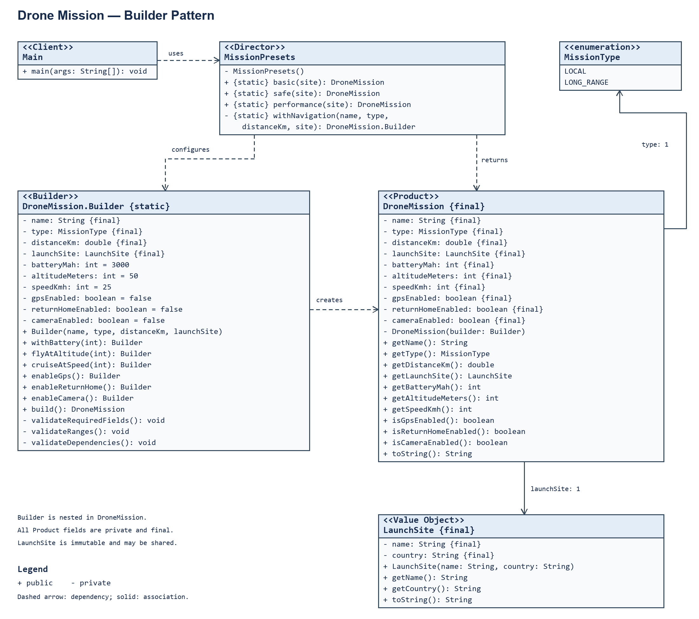

# Assignment 1 — Builder Pattern for a Drone Mission

Repository: https://github.com/zubaniazsalim-afk/asik-1

This project demonstrates the transition from a constructor with ten arguments to step-by-step object creation using Builder. A completed mission is immutable, and invalid parameter combinations are rejected before it is created. The implementation uses only standard Java 17 features.

## 1. Individual variant and problem

**Domain:** Drone Mission. **Constraint:** a `LONG_RANGE` mission requires GPS to be enabled and a battery capacity of at least 5000 mAh. **Required preset:** SAFE.

This working variant was taken from the example in the assignment; assignment or approval by the instructor has not yet been confirmed. The complete combination must be approved and match the student's individual variant.

An additional constraint requires GPS for automatic return home. In this model, a long-range flight is identified by `MissionType.LONG_RANGE`, rather than inferred automatically from distance. The numerical limits are conditions of the educational model, not physical flight-range calculations or operating rules for a real drone.

The application creates configurations for a training flight, a safe mode, and a long-range flight with a camera. These configurations have different settings but share the same consistency rules.

## 2. Product properties

| Property | Type | Required | Default value and meaning |
|---|---|---|---|
| name | String | Yes | Mission name |
| type | MissionType | Yes | LOCAL or LONG_RANGE |
| distanceKm | double | Yes | Distance in kilometers |
| launchSite | LaunchSite | Yes | Nested launch location object |
| batteryMah | int | No | 3000 mAh, basic battery |
| altitudeMeters | int | No | 50 meters, basic altitude |
| speedKmh | int | No | 25 km/h, basic speed |
| gpsEnabled | boolean | No | false, navigation is enabled explicitly |
| returnHomeEnabled | boolean | No | false, return home is enabled explicitly |
| cameraEnabled | boolean | No | false, the camera is enabled when needed |

There are 10 meaningful properties: 4 required and 6 optional. The types include String, enum, double, int, boolean, and the LaunchSite object. The defaults are suitable for BASIC. LONG_RANGE requires explicit changes to the GPS and battery settings.

## 3. Initial constructor-based solution

The complete initial implementation is preserved in commit `40059d3` and can be viewed using the commands in the README. The actual client code at that stage was:

```java
LaunchSite site = new LaunchSite("Training field", "Kazakhstan");
DroneMission mission = new DroneMission("Safe flight", MissionType.LOCAL,
        3, site, 5000, 40, 20, true, true, false);
System.out.println(mission);
```

The constructor accepted all ten properties and assigned them to fields. It already checked the name, type, and distance, but full dependency validation had not yet been implemented.

Specific design problems:

1. `5000`, `40`, and `20` all have type `int`. Swapping altitude and speed would still compile and could produce valid numbers with the wrong meaning. Builder method names explain what each number represents.
2. `true, true, false` does not reveal which features are enabled. Understanding the call requires opening the constructor declaration and counting argument positions.
3. Even BASIC requires every setting to be supplied. Defaults would need to be repeated in every call or supported through additional constructor overloads.
4. A new optional property requires changing the long signature and its callers, or adding another overload. Builder can introduce a separate method and a default without changing existing client code.
5. The initial implementation allowed LONG_RANGE without GPS. Builder alone does not fix this: an explicit check before Product creation does. Such validation could also be added to a conventional constructor, but that would not solve the readability problems of its calls.

## 4. Builder solution and code explanation

The equivalent safe configuration can be written as follows:

```java
DroneMission mission = new DroneMission.Builder("Safe flight", MissionType.LOCAL, 3, site)
        .withBattery(5000)
        .flyAtAltitude(40)
        .cruiseAtSpeed(20)
        .enableGps()
        .enableReturnHome()
        .build();
```

`new DroneMission.Builder(...)` creates a temporary configuration object and accepts four required values. Optional fields already have defaults. For example, `withBattery(5000)` changes the battery setting in the Builder and returns that same Builder.

```java
public Builder withBattery(int batteryMah) {
    this.batteryMah = batteryMah;
    return this;
}
```

Here, `this.batteryMah` is the object's field, while `batteryMah` on the right is the method argument. `return this` allows the next method to be called immediately after a dot. This is called a fluent API or method chaining. It does not create a separate mission at each step.

```java
public DroneMission build() {
    validateRequiredFields();
    validateRanges();
    validateDependencies();
    return new DroneMission(this);
}
```

`build()` first validates all settings, then passes the Builder to the private Product constructor. The constructor copies values into the completed mission's fields, for example `this.batteryMah = builder.batteryMah`. If validation throws an exception, the Product creation statement is never executed.

`private` prevents outside code from accessing a field or constructor directly. A `final` field cannot be reassigned. Product has no methods that modify its fields. The class is also declared `final`, so it cannot be extended by a subclass that changes the model's guarantees.

`public static class Builder` is a nested class. `static` means that creating a Builder does not require an existing mission. `MissionType` is an enum with two named values instead of arbitrary strings. `LaunchSite` stores a location name and country, validates them in its constructor, and also prevents field changes.

`getBatteryMah()`, `isGpsEnabled()`, and the other getters only read values. `toString()` creates a text representation of a mission. Console output belongs to `Main`, rather than Product or Builder.

## 5. Participants and UML



| Role | Class | Responsibility |
|---|---|---|
| Product | DroneMission | Stores a completed immutable mission |
| Builder | DroneMission.Builder | Collects settings, validates them, and creates Product |
| Client | Main | Creates a launch site, calls presets, and prints results |
| Director | MissionPresets | Stores reusable BASIC, SAFE, and PERFORMANCE recipes |
| Value object | LaunchSite | Stores and validates the launch location name and country |
| Supporting enum | MissionType | Restricts the available mission types |

The UML shows the fields, operations, nested Builder, and dependencies of the actual code. A solid arrow represents an association with the mission type or launch site; a dashed arrow represents a dependency. Multiple missions may share a LaunchSite, so it is shown as an ordinary association rather than exclusive composition. The test class is not a participant in the pattern.

## 6. Validation

| Check | Rule | Location |
|---|---|---|
| Name | Not null and not blank | validateRequiredFields |
| Type | Not null | validateRequiredFields |
| Launch site | Not null | validateRequiredFields |
| Distance | Finite number, 0 < distanceKm <= 50 | validateRanges |
| Battery | 1000–20000 inclusive | validateRanges |
| Altitude | 1–120 inclusive | validateRanges |
| Speed | 1–60 inclusive | validateRanges |
| Cross-field rule 1 | LONG_RANGE requires GPS and batteryMah >= 5000 | validateDependencies |
| Cross-field rule 2 | returnHomeEnabled requires gpsEnabled | validateDependencies |
| LaunchSite fields | Name and country must not be null or blank | LaunchSite constructor |

`Double.isFinite` rejects NaN and infinity: ordinary boundary comparisons are insufficient for NaN. Invalid settings produce an `IllegalArgumentException` with a specific message. For example, a long-range flight with GPS and a 4999 mAh battery produces `LONG_RANGE requires GPS and battery of at least 5000 mAh`.

Validation occurs in `build()` because individual Builder steps may temporarily form an incomplete combination. Calling `enableReturnHome()` before `enableGps()` is allowed. What matters is the consistency of the finished result, rather than the order of independent settings. LaunchSite is validated separately when it is created because it is a standalone object with its own simple rules.

## 7. Three presets

| Parameter | BASIC | SAFE | PERFORMANCE |
|---|---|---|---|
| Type | LOCAL | LOCAL | LONG_RANGE |
| Distance | 1 km | 3 km | 20 km |
| Battery | 3000 | 5000 | 8000 |
| Altitude | 50 | 40 | 100 |
| Speed | 25 | 20 | 60 |
| GPS | Disabled | Enabled | Enabled |
| Return home | Disabled | Enabled | Enabled |
| Camera | Disabled | Disabled | Enabled |

BASIC demonstrates the defaults. SAFE reduces speed and altitude while adding navigation and a larger battery. PERFORMANCE uses a long-range flight, a camera, and higher settings. SAFE is the name of an educational recipe, not a guarantee of real-world flight safety.

The Director is a simple class with static methods, without an additional interface. The `withNavigation` method combines the shared GPS and return-home steps for SAFE and PERFORMANCE. The entire Builder sequence is not copied three times. BASIC uses defaults, while the other recipes add their specific settings. Every preset call creates a new Builder.

## 8. Clean Code Chapter 3 — three actual before-and-after examples

### Example 1 — fewer arguments and descriptive names

Before, `Main.java` in commit `40059d3`:

```java
DroneMission mission = new DroneMission("Safe flight", MissionType.LOCAL,
        3, site, 5000, 40, 20, true, true, false);
```

After, `Main.java` in commit `bb11d45`:

```java
DroneMission mission = new DroneMission.Builder("Safe flight", MissionType.LOCAL, 3, site)
        .withBattery(5000)
        .flyAtAltitude(40)
        .cruiseAtSpeed(20)
        .enableGps()
        .enableReturnHome()
        .build();
```

Problem: ten positional arguments and unclear boolean flags. Principles: minimizing function arguments, descriptive names, and avoiding flag arguments in the client API. After the change, method names explain each number, and enabling GPS is expressed as an action. The four required arguments remain together as the minimum basis for a mission. In the final code, this recipe is moved into the Director.

### Example 2 — small functions and one level of abstraction

Before, the entire `build()` method in commit `bb11d45`:

```java
public DroneMission build() {
    if (name == null || name.isBlank()) {
        throw new IllegalArgumentException("Mission name must not be blank");
    }
    if (type == null) {
        throw new IllegalArgumentException("Mission type is required");
    }
    if (!Double.isFinite(distanceKm) || distanceKm <= 0 || distanceKm > 50) {
        throw new IllegalArgumentException("Distance must be greater than 0 and at most 50 km");
    }
    return new DroneMission(this);
}
```

After, the current `build()` method:

```java
public DroneMission build() {
    validateRequiredFields();
    validateRanges();
    validateDependencies();
    return new DroneMission(this);
}
```

Problem: the high-level creation operation was mixed with detailed conditions. Adding more checks would make the method longer. Principles: small functions, one responsibility per function, and one level of abstraction. Now `build()` describes the creation stages, while three helper methods validate separate groups of rules. Adding a dependency rule does not clutter the main workflow.

### Example 3 — separating recipes from Client and applying DRY

Before, the actual sequence from `Main.java` in commit `bb11d45` is shown in Example 1. The client specified all SAFE settings itself. Reusing the recipe elsewhere would introduce a risk of copying it and ending up with inconsistent values.

After, the current Client calls the recipe:

```java
System.out.println(MissionPresets.safe(site) + " \uD83C\uDF4C");
```

The shared part of two recipes in the current `MissionPresets.java`:

```java
private static DroneMission.Builder withNavigation(String name, MissionType type,
                                                   double distanceKm, LaunchSite site) {
    return new DroneMission.Builder(name, type, distanceKm, site)
            .enableGps()
            .enableReturnHome();
}
```

Principles: one responsibility, DRY, and descriptive names. Main handles the demonstration; the Director handles recipes. Shared navigation steps can be changed in one method. This does not claim that the original code already contained three copies: initially, there was one recipe, which was extracted before the others were added.

These examples demonstrate at least six Chapter 3 principles: small functions, one responsibility, descriptive names, one level of abstraction, minimizing arguments, avoiding flag arguments, and DRY. Errors are also reported through exceptions rather than hidden. Builder intentionally changes its own state; full Command–Query Separation is not claimed for fluent methods because they modify the object and return it for chaining.

## 9. Design decisions and alternatives

**Decision 1: validate settings in Builder before creating Product.** An alternative is to perform all validation in the Product constructor. Constructor validation is especially useful when there are several creation paths. Here, the constructor is private and called only from `build()`, so validation remains in one place without duplication. If another mission creation path is introduced, the validation design must be reconsidered.

**Decision 2: an immutable Product and a reusable Builder.** Alternatives include a mutable mission with setters or a single-use Builder. An immutable mission preserves its validated settings. Each `build()` creates a new object and copies field values. LaunchSite is shared by reference, which is safe because it is also immutable. A mutable list would require defensive copying. Reuse is convenient for similar missions; previous optional settings remain until explicitly changed. Required Builder fields cannot be reassigned. Builder is not intended to be shared between multiple threads.

**Decision 3: a small Director.** An alternative is to write all three recipes directly in Main. The Director is useful here because both the client and tests use the presets, and two presets share construction steps. An additional hierarchy of Builder interfaces is unnecessary: there is only one Product, so it would complicate this educational example.

## 10. Automated testing

Tests are in `test/DroneMissionTest.java`. This is an executable test class without third-party libraries. `check` verifies a condition and throws `AssertionError` on failure, causing the process to exit with a nonzero status. The `-ea` flag is not required. `expectInvalid` checks both the `IllegalArgumentException` and its exact message; if an invalid object is created, the test fails.

| Requirement | Actual checks |
|---|---|
| 3 valid scenarios | BASIC, SAFE, and PERFORMANCE with property checks |
| 3 invalid scenarios | Blank name, missing type, and missing launch site, plus other errors |
| 2 boundary scenarios | Minimum valid integer settings and a positive distance; maximum valid values |
| Individual constraint | LONG_RANGE without GPS; 4999 mAh with GPS; successful construction at 5000 mAh with GPS |
| Product independence | After modifying and reusing Builder, the first mission retains its original battery and camera settings |
| Additional checks | NaN, infinity, out-of-range values, return-home dependency, invalid LaunchSite, and failed Builder reuse |

The 0.01 km distance in the lower-boundary test is an example of a valid positive distance, not the smallest positive double value. The strict lower distance boundary of 0 is covered by a separate failing scenario.

Verification on JDK 17.0.12: `javac -encoding UTF-8 -Xlint:all` compiled without warnings, and all 31 test cases passed. These are 31 behavior checks grouped into related methods, rather than merely 31 calls to Product methods.

## 11. Actual sample output

```text
Basic flight: LOCAL, distance=1.0 km, site=Training field, Kazakhstan, battery=3000 mAh, altitude=50 m, speed=25 km/h, GPS=false, returnHome=false, camera=false
Safe flight: LOCAL, distance=3.0 km, site=Training field, Kazakhstan, battery=5000 mAh, altitude=40 m, speed=20 km/h, GPS=true, returnHome=true, camera=false 🍌
Performance flight: LONG_RANGE, distance=20.0 km, site=Training field, Kazakhstan, battery=8000 mAh, altitude=100 m, speed=60 km/h, GPS=true, returnHome=true, camera=true
```

As required by the assignment, the emoji is added to the output of exactly one successfully built configuration: SAFE. The final line of the test run is:

```text
All 31 tests passed.
```

## 12. Development history

The stages were saved in sequence, rather than reconstructed retrospectively from one final state:

| Commit | Change |
|---|---|
| b5772d0 | Mission types and immutable LaunchSite |
| 40059d3 | Initial implementation with a ten-parameter constructor |
| bb11d45 | Fluent Builder, defaults, and private Product constructor |
| 9c3a8a4 | Full validation and extraction of small functions |
| ab7ba12 | Three presets and Director |
| 065fb1e | Tests for valid construction, boundaries, and Product independence |
| 752bec9 | Report, README, UML, and defense preparation |

The English translation is saved in a subsequent commit. The complete history is available through `git log --oneline --reverse`.

## 13. Defense preparation and changing requirements

**Why Builder?** A mission has many optional parameters and dependencies. Named steps make the settings easier to understand than positional numbers and flags. A conventional constructor would be sufficient for an object with two simple fields.

**How does Builder differ from Product?** Builder is a mutable draft. Product is a completed, validated mission. `build()` connects these two stages.

**What does return this do?** It returns the same Builder for the next call in the chain. A new Product is created only inside `build()`.

**Why is final insufficient for every nested structure?** `final` prevents replacing a reference, but does not prevent modifying the referenced object. Here, LaunchSite itself is immutable. A list would require an immutable copy.

**What happens with .enableReturnHome().build() without GPS?** An `IllegalArgumentException` is thrown, and no object is created. Adding `.enableGps()` before `build()` satisfies this dependency.

**How can an optional property be added?** For example, to add `flightMinutes`, add a Product field and getter, a Builder field with a default, a named Builder method, and copying in the private constructor. Then add range validation and tests, and update the UML. Existing calls continue to work because of the default.

**How can a conditionally required setting be added?** If using a camera must require at least 4000 mAh, add the condition `cameraEnabled && batteryMah < 4000` and an exception to `validateDependencies()`. Write a failing test at 3999 and a successful test at 4000 with the camera enabled. Check existing presets: PERFORMANCE has an 8000 mAh battery.

**How can a new preset be added?** Add a named static method to MissionPresets, create the configuration using Builder, and use withNavigation if needed. Then add a test of the actual properties and update the table and UML.

**How can a default be changed?** Change the initial value of the Builder field. Explicit calls such as `.withBattery(5000)` still take priority. The BASIC test must be updated because it deliberately checks defaults; SAFE and PERFORMANCE use explicit battery values.

**How can Builder reuse be prohibited?** Add a `built` flag to Builder, check it in `build()`, and set it after successful validation. A second `build()` should then fail; the independence test must be replaced or supplemented with a test for this behavior. The current version intentionally allows reuse.

Before the defense, be able to trace Main → MissionPresets → Builder → validation → Product independently, explain every if statement, and modify at least one rule together with its test. The code and report were prepared with AI assistance; responsibility for understanding the work and following course rules remains with the student submitting it.
