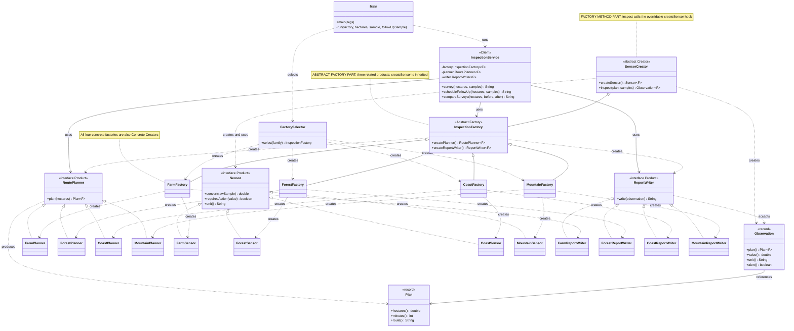

# Assignment 2 — Environmental Drone Inspections

**Patterns:** Factory Method and Abstract Factory. **Language:** Java 17. **Repository:** [Assignment 2 branch](https://github.com/zubaniazsalim-afk/asik-1/tree/codex/assignment-2).

The application creates a compatible inspection system for a selected environment. A route planner, sensor, and report writer collaborate to perform surveys, plan follow-up visits, and compare inspection results. Farm, Forest, and Coast are the original families; Mountain was added later as a separate extension.

## 1. Domain and product families

Environmental inspections use different routes, calibration rules, units, alert conditions, and response instructions. A farm measures soil moisture; a forest inspection checks temperature; a coastal inspection estimates oil concentration. Combining a farm observation with a forest report could turn an irrigation problem into a fire warning. This gives the family compatibility rule a concrete meaning.

The measurements and thresholds below are deliberately simple educational assumptions. Inputs are simulated raw readings, not real hardware data. These rules are not scientifically validated or operational flight guidance.

| Family | RoutePlanner product | Sensor product | ReportWriter product |
|---|---|---|---|
| Farm | FarmFactory.FarmPlanner | FarmFactory.FarmSensor | FarmFactory.FarmReportWriter |
| Forest | ForestFactory.ForestPlanner | ForestFactory.ForestSensor | ForestFactory.ForestReportWriter |
| Coast | CoastFactory.CoastPlanner | CoastFactory.CoastSensor | CoastFactory.CoastReportWriter |
| Mountain, added later | MountainFactory.MountainPlanner | MountainFactory.MountainSensor | MountainFactory.MountainReportWriter |

There were nine original concrete products. The completed project contains twelve. The nested products are actual separate classes, not one product with a family-name switch.

| Family | Route | Minutes per hectare | Conversion | Alert rule | Action |
|---|---|---:|---|---|---|
| Farm | Parallel crop rows | 3 | raw / 10, moisture % | value < 30 | Irrigate crops |
| Forest | Canopy grid with firebreak corridors | 4 | raw / 10, temperature C | value >= 60 | Send fire patrol |
| Coast | Shoreline transects | 5 | raw / 100, oil mg/L | value >= 2 | Deploy containment booms |
| Mountain | Contour route around steep slopes | 6 | raw / 10, snow cm | value >= 50 | Close trail for snow clearance |

Duration is rounded up with `Math.ceil`. Reports also have family-specific instructions for normal readings. The differences change results and follow-up scheduling, rather than merely changing printed family names.

## 2. Part A — the initial solution without factories

Commit `87322b7` contains the original working version. Main directly creates three concrete Farm products:

```java
FarmPlanner planner = new FarmPlanner();
FarmSensor sensor = new FarmSensor();
FarmReportWriter writer = new FarmReportWriter();
String route = planner.plan(10);
double moisture = sensor.measure(180);
System.out.println(writer.write(route, moisture));
```

Three concrete problems are visible in that implementation:

1. Main depends on `FarmPlanner`, `FarmSensor`, and `FarmReportWriter`. Switching environments requires editing the client and replacing all three constructors.
2. Every new entry point would have to remember and repeat the correct group of constructors. Missing one replacement can produce a mismatched system.
3. Products exchange an ordinary String and double. The type system cannot distinguish farm moisture from another family's numeric observation; an unrelated measurement could reach the Farm report.

The initial model is intentionally small and supports one environment. It does not claim to contain a large switch that was never present. Commit `b7c7af0` then adds product interfaces and typed data before the factory refactoring.

## 3. Part B — Factory Method

`SensorCreator<F>` is the abstract Creator. `Sensor<F>` is its Product interface. The four concrete sensor classes are Concrete Products. FarmFactory, ForestFactory, CoastFactory, and MountainFactory are Concrete Creators because they override the inherited `createSensor()` factory method.

```java
public abstract Sensor<F> createSensor();
```

The concrete override in FarmFactory is:

```java
@Override
public Sensor<Family> createSensor() { return new FarmSensor(); }
```

The creation hook itself is short, but the Creator also contains the meaningful `inspect(plan, samples)` workflow:

1. Require a plan and at least one sample.
2. Obtain the sensor through the overridable `createSensor()` method.
3. Reject non-finite readings and readings outside 0–1000.
4. Convert every sample using the selected sensor's calibration.
5. Average calibrated values to reduce measurement noise.
6. Ask the sensor whether the average requires action and create a typed Observation.

Averaging is the chosen policy; isolated peaks can be smoothed out. This is an explicit educational trade-off, not a fire-safety detection algorithm.

**Why Factory Method rather than a static factory?** An inherited business operation calls an instance method whose implementation is selected through subclass overriding. `FactorySelector.select()` is a separate static selection helper; it is not the evidence for Factory Method. The test factory counts `createSensor()` calls to prove that the Creator workflow uses the overridden hook.

## 4. Part C — Abstract Factory

`InspectionFactory<F>` extends `SensorCreator<F>` and adds the other related product types:

```java
public abstract class InspectionFactory<F extends InspectionFamily> extends SensorCreator<F> {
    public abstract RoutePlanner<F> createPlanner();
    public abstract ReportWriter<F> createReportWriter();
    // createSensor() is inherited from SensorCreator.
}
```

Its public contract therefore creates all three required product types: RoutePlanner, Sensor, and ReportWriter. Each concrete factory implements all three creation methods for one family.

The concrete factories deliberately play two roles. As Abstract Factories, they supply a complete family. As Concrete Creators, they override the sensor Factory Method used inside `inspect()`. Combining these roles avoids redundant creator classes that would only delegate to a factory. The two patterns remain distinguishable by their responsibilities and are marked separately in the UML.

## 5. Part D — compatibility by design

Every family defines its own nested marker type, for example `FarmFactory.Family`. The marker carries no runtime data. `F` is a generic type parameter meaning "the same inspection family throughout this operation."

The family parameter is preserved through all of these types:

```text
InspectionFactory<F>
  RoutePlanner<F> -> Plan<F>
  SensorCreator<F> + Plan<F> -> Observation<F>
  ReportWriter<F> accepts Observation<F>
  InspectionService<F> uses the same factory, planner, and writer
```

`InspectionService` accepts one factory, rather than three independently selected products. That factory supplies both stored products and the sensor creation workflow. The client cannot accidentally inject a Farm planner and Forest writer separately.

This is valid:

```java
FarmFactory farm = new FarmFactory();
var observation = farm.inspect(farm.createPlanner().plan(10), 180);
farm.createReportWriter().write(observation);
```

This is rejected by Java at compilation:

```java
new ForestFactory().createReportWriter().write(observation);
```

The writer requires `Observation<ForestFactory.Family>`, but the supplied observation has type `Observation<FarmFactory.Family>`. Passing a Farm plan to a Forest Creator also fails, as does passing ForestFactory to `InspectionService<FarmFactory.Family>`.

There is no `if (wrongFamily)` check. Automated tests run the Java compiler on valid and invalid snippets and verify actual type-mismatch diagnostics. A matching pipeline must compile first, preventing missing dependencies from being mistaken for a compatibility success.

The guarantee applies to correctly typed Java code following the factory contracts. Deliberate raw types, unsafe casts, reflection, or dishonest custom implementations can bypass ordinary type guarantees. The project uses none of those techniques and compiles with all warnings treated as errors. This architecture does not claim to protect against malicious code.

## 6. Part E — runtime selection

Main reads the family from the first command-line argument. `FactorySelector` normalizes the name and selects the concrete factory in one switch. Only this initialization component knows the available family names.

```text
Main coast 10 300 100
```

The selected value has type `InspectionFactory<?>`: a factory exists, but its particular family is unknown at that point. Main passes it to the generic `run` helper, which preserves one consistent family type while creating `InspectionService<F>`.

After selection, business logic uses abstractions. InspectionService contains no Farm, Forest, Coast, or Mountain checks. The default is Farm; unknown or blank family names are rejected clearly. The selector switch is acceptable at this boundary because it is centralized rather than spread through business operations.

## 7. Part F — three business operations

### Survey

`survey(hectares, samples)` obtains a route from the selected planner, passes it and the readings into the Creator workflow, and gives the resulting Observation to the matching report writer. The report contains the route, calibrated average, unit, and recommended action.

### Follow-up scheduling

`scheduleFollowUp(hectares, samples)` performs an inspection and uses its alert result. If there is no alert, it reports that another flight is unnecessary. If there is an alert, it asks the same family planner for a route covering one quarter of the area and reports the additional duration alongside the inspection report.

For a Farm survey covering 10 hectares, a follow-up covers 2.5 hectares and requires `ceil(2.5 * 3) = 8` minutes. A Coast revisit over the same area requires 13 minutes. The quarter-area revisit is a planning policy; the program has no geographic samples and does not identify which coordinates are affected.

### Before-and-after comparison

`compareSurveys(hectares, beforeSample, afterSample)` creates two observations using the same family and reports their alert-state transition. An alert disappearing gives RESOLVED; an alert appearing gives NEW_ALERT; persistent alerts give STILL_ALERT; two normal readings give CLEAR. Both detailed family reports are included.

The client compares alert states, not whether the number increased or decreased. Higher moisture can help a farm, while higher oil concentration can harm the coast. The sensor handles that domain difference.

## 8. Part G — fourth-family extension

The three-family system and its 53 tests were complete in commit `2a0ab98`. Mountain was then added in commit `d258469`.

Exactly these files changed in that extension commit:

| File | Change |
|---|---|
| src/MountainFactory.java | Added the factory, marker type, MountainPlanner, MountainSensor, and MountainReportWriter |
| src/FactorySelector.java | Added one `mountain` selection case |
| test/InspectionTest.java | Added nine checks for the new products, selection, threshold, operations, and incompatible data |

No existing planner, sensor, writer, Creator workflow, Abstract Factory contract, InspectionService operation, or Main method changed. The selector is the single existing production file that required modification. The final README and report were created afterward to document the completed project.

Verification commands:

```sh
git diff --name-status 2a0ab98 d258469
git diff 2a0ab98 d258469 -- src/InspectionService.java src/SensorCreator.java src/Main.java
```

The second command has empty output. A later documentation-only wording correction clarifies the follow-up policy comment without changing behavior.

## 9. Part H — UML class diagram

GitHub renders the following Mermaid class diagram. `FarmPlanner` and the other shortened concrete-product labels refer to the public static nested classes inside their corresponding family factory. Every concrete family also owns its distinct nested `Family` marker implementing InspectionFamily.



A solid line ending in a hollow triangle represents inheritance; a dashed line with a hollow triangle represents interface implementation. Dashed arrows represent dependencies such as creation. Solid arrows represent stored references. `F` denotes one family shared throughout each typed pipeline. The diagram omits validation helpers and marker declarations to keep the pattern relationships readable.

## 10. Part I — automated tests

`test/InspectionTest.java` is an executable test suite without external libraries. It uses explicit checks and AssertionError, so Java's `-ea` flag is unnecessary. A failing check terminates the run with a nonzero exit code. There are **62 passing checks**, exceeding the required 15.

| Requirement | Evidence |
|---|---|
| Each original family | Product creation and complete survey behavior for Farm, Forest, and Coast |
| Correct concrete products | Nine original product-type checks and three Mountain product-type checks |
| Compatibility | Valid pipeline compiles; incompatible writer, client, and plan fail with type-mismatch diagnostics |
| Runtime selection | All four family names, normalized input, unknown, null, and blank input |
| At least three business tests | Exact survey output, follow-up duration, skipped follow-up, and all four comparison states |
| At least two negative scenarios | Invalid area, sample, plan, factory, empty samples, and unknown family |
| Fourth family | Nine checks including all three operations and rejection of Farm data |
| Client uses abstractions | TestFactory provides unrelated fake products; the unchanged client runs all operations |
| Factory Method behavior | TestFactory counts sensor creations during the inherited inspect workflow |
| Boundaries | Raw sample endpoints, area limits, thresholds, and rounded durations |

The fake factory is defined only inside the test class. It is intentionally unrelated to the four production environments, proving that the business client is not secretly tied to known concrete classes.

The compiler tests create short source snippets in memory and compile them against the application's classes. A temporary output directory is removed after each check. Unexpected compiler errors fail the test rather than being counted as correct family rejection.

Verification used JDK 17.0.12 with `-encoding UTF-8 -Xlint:all -Werror`. All source and test files compiled without warnings. All 62 checks passed. Command-line scenarios for all four environments and invalid inputs were also checked.

## 11. Part J — meaningful development history

Assignment 2 is developed on `codex/assignment-2`; Assignment 1 remains on `master`. The following are eight Assignment 2 commits, excluding the inherited Assignment 1 history:

| Commit | Actual development stage |
|---|---|
| 87322b7 | Initial working domain model with direct creation and no factories |
| b7c7af0 | Product interfaces and family-aware immutable data |
| 056bbe0 | Factory Method with calibration and sample averaging |
| 04ae12f | Three original families and nine concrete products |
| 6c8cc2b | Abstract Factory and three business operations |
| e93cada | Runtime selection through command-line arguments |
| 2a0ab98 | 53 tests, including compile-time compatibility |
| d258469 | Fourth family added without changing business logic |

A following documentation commit adds the README, report, and embedded UML. These stages were implemented and saved in sequence; the initial and three-family versions remain inspectable in Git.

## 12. Sample output

Command: `Main farm 10 180 400`.

```text
SURVEY | FARM | Parallel crop rows | 18.00 % moisture | Irrigate crops
FOLLOW-UP | Revisit 2.5 ha for 8 min | FARM | Parallel crop rows | 18.00 % moisture | Irrigate crops
COMPARISON | RESOLVED
Before: FARM | Parallel crop rows | 18.00 % moisture | Irrigate crops
After: FARM | Parallel crop rows | 40.00 % moisture | No irrigation needed
```

Command: `Main mountain 10 600 200`.

```text
SURVEY | MOUNTAIN | Contour route around steep slopes | 60.00 cm snow | Close trail for snow clearance
FOLLOW-UP | Revisit 2.5 ha for 15 min | MOUNTAIN | Contour route around steep slopes | 60.00 cm snow | Close trail for snow clearance
COMPARISON | RESOLVED
Before: MOUNTAIN | Contour route around steep slopes | 60.00 cm snow | Close trail for snow clearance
After: MOUNTAIN | Contour route around steep slopes | 20.00 cm snow | Keep trail open
```

## 13. Simple code explanations and defense preparation

**Interface:** a contract listing the operations a product must support. The client can call `plan`, `convert`, or `write` without naming the concrete class.

**Abstract class:** shared code with operations left for subclasses to implement. SensorCreator contains the common inspect algorithm and leaves createSensor abstract.

**Override:** the subclass supplies its own implementation of an inherited method. FarmFactory returns FarmSensor; CoastFactory returns CoastSensor.

**Generic F:** a compile-time label connecting a factory, its products, and their data. It prevents accidentally passing an observation from one environment to another environment's writer. It does not involve a runtime family-name comparison.

**Record:** a short Java declaration for immutable data. Plan stores area, duration, and route; Observation stores the plan, reading, unit, and alert. Their constructor checks reject invalid data.

**Nested static class:** a class grouped inside another class. The concrete products are nested in their family factory to reduce file count. Each remains a separate class, and none needs an enclosing factory instance to exist.

**Varargs `double... samples`:** callers may supply one or several readings. Inside the method, Java exposes them as an array. The Creator loops through that array and computes an average.

**`var`:** Java infers a local variable's type from its assigned value. The type is still checked at compilation; it does not become dynamically typed.

**Why two patterns?** Factory Method lets the shared inspection algorithm choose a sensor through overriding. Abstract Factory supplies a matching planner, sensor, and writer for a complete environment.

**Where would a fifth family be added?** Add its factory file with a marker and three products, register one selector case, add tests, and update the documentation. Existing business operations should remain unchanged.

**What if a fourth product type were required?** Extend the Abstract Factory contract and implement it in every family. Abstract Factory makes adding families easy, but adding a new product type requires coordinated changes across factories.

**What if the alert threshold changes?** Change the relevant sensor's requiresAction method and its boundary tests. The inspection service should not change.

**What is the cost of this design?** Generics and multiple small product classes require more initial code than direct construction. They are justified by family compatibility and the demonstrated fourth-family extension. The project avoids extra creator wrappers, dependency injection frameworks, reflection-based registration, and a build system.

Before the defense, trace Main → FactorySelector → InspectionService → planner → SensorCreator.inspect → createSensor → sensor → report writer. Be ready to explain every arrow in the UML, modify one threshold, and rerun the related tests. This work was prepared with AI assistance; the student is responsible for understanding and defending it.
